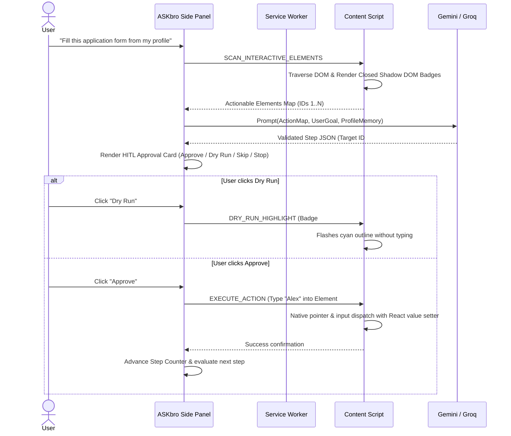

# ASKbro — AI Browser Agent for Web Browsers

<p align="center">
  
</p>

<p align="center">
  <strong>The Chrome Side-Panel AI Agent that understands web pages and acts strictly under human control.</strong>
</p>

<p align="center">
  <a href="#key-features"></a>
  <a href="#key-features"></a>
  <a href="#key-features"></a>
  <a href="#key-features"></a>
  <a href="#key-features"></a>
  <a href="#testing"></a>
  <a href="#license"></a>
</p>

---

## 📖 Table of Contents

- [Overview & Philosophy](#-overview--philosophy)
- [System Architecture](#-system-architecture)
- [Key Features](#-key-features)
  - [Phase 1: The Eyes (Read the Web)](#1-the-eyes-read-the-web)
  - [Phase 2: The Brain (Understand Page & Screen)](#2-the-brain-understand-page--screen)
  - [Phase 3: The Hands (Act With User Approval)](#3-the-hands-act-with-user-approval)
  - [Phase 4: Memory, Safety & Packaging](#4-memory-safety--packaging)
- [Deterministic Safety Matrix](#-deterministic-safety-matrix)
- [Installation & Quickstart](#-installation--quickstart)
- [Configuring API Keys](#-configuring-api-keys)
- [Hands-On Practice Sandbox](#-hands-on-practice-sandbox)
- [Project Layout](#-project-layout)
- [Testing & Verification](#-testing--verification)
- [Packaging & GitHub Releases](#-packaging--github-releases)
- [License](#-license)

---

## 🎯 Overview & Philosophy

Most AI browser assistants suffer from one of two extremes:
1. **Passive Chatbots**: Isolated in separate tabs where users must constantly copy-paste page text, explain the context, and execute every single step manually.
2. **Black-Box Autonomous Bots**: Operate with unchecked autonomy, risking catastrophic clicks, entering sensitive data, or triggering unwanted purchases.

**ASKbro** strikes the ideal balance: a **user-controlled AI co-pilot** docked inside Chrome's native Side Panel. ASKbro inspects the open web page, maps actionable elements with non-destructive Shadow DOM badges, proposes one action at a time, and executes **strictly after the user clicks "Approve"**.

### Core Tenets
- 🛡️ **Zero Rogue Actions**: Every browser mutation requires explicit Human-In-The-Loop (HITL) approval or a harmless "Dry Run".
- 🔒 **Deterministic Safety by Code**: Hardcoded client-side rules block banking portals, passwords, and OTPs before the AI can see them.
- 💾 **Local-First Privacy**: Stored user profiles, custom skills, and execution logs reside 100% inside `chrome.storage.local`. Zero external telemetry.
- ⚡ **Free-Tier Resilience**: Runs smoothly on Gemini 1.5 Flash-Lite with automatic exponential backoff and seamless Groq Cloud API fallback.

---

## 🏛️ System Architecture

ASKbro is engineered for Google Chrome **Manifest V3**:

```
+----------------------------------------------------------------------------------------------------+
|                                    ASKbro CHROME MV3 TOPOLOGY                                      |
|                                                                                                    |
|  [Active Chrome Tab]                                   [Side Panel (React 18 + Tailwind)]          |
|   ├── Content Script (reader.ts, youtube.ts)            ├── App.tsx (Root Shell)                   |
|   ├── Scanner (scanner.ts)                              ├── SummaryCard.tsx (Readability + YT)     |
|   │    └── Closed Shadow DOM (#askbro-badge-root)       ├── ChatView.tsx (Grounded Q&A SSE)        |
|   └── Executor (executor.ts: Native pointer/keyboard)   ├── ActionCard.tsx (HITL Approval Loop)    |
|                                                         ├── ScreenshotModal.tsx (Vision Inspector) |
|                     ▲                                   └── SkillsLibrary.tsx (1-Click Presets)    |
|                     │ Message Channel (Port/Runtime)                     ▲                         |
|                     ▼                                                    │                         |
|  [Background Service Worker (index.ts)] ─────────────────────────────────┘                         |
|   ├── stateManager.ts  ──▶ Persists step states into chrome.storage.session                        |
|   ├── captureHandler.ts──▶ Captures viewport via chrome.tabs.captureVisibleTab                     |
|   ├── menuHandler.ts   ──▶ Context menus (Explain, Translate, Draft reply)                         |
|   └── rateLimiter.ts   ──▶ Dual AI Router: Gemini 1.5 Flash-Lite ──[Fallback on 429]──▶ Groq Cloud  |
|                                                                                                    |
|  [Deterministic Safety Rails (services/safety)]                                                    |
|   ├── domainGuard.ts        (Hard-blocks banking & payment domains)                                |
|   ├── fieldGuard.ts         (Completely strips password, OTP, CVV, and card inputs)                |
|   └── consequentialGuard.ts (Requires explicit toggle for Submit, Pay, and Delete buttons)         |
+----------------------------------------------------------------------------------------------------+
```

### Action Approval Loop



---

## ✨ Key Features

### 1. The Eyes: Read the Web
- **Mozilla Readability Article Extraction**: Strips clutter, navigation, and ads to produce structured 3-part briefs:
  - **TL;DR**: Exactly one crisp sentence.
  - **5 Key Takeaways**: Bullet points with bold lead-ins.
  - **Actionable Next Steps**: 2–3 concrete suggestions.
- **Interactive YouTube Video Summaries**:
  - Automatically detects YouTube watch pages and scrapes video title, channel, description, and chapters.
  - Produces timestamped notes (`mm:ss`). Clicking any timestamp in the side panel seeks the video player instantly (`videoElement.currentTime = seconds`).
- **Bilingual English & Hinglish**:
  - Instant toggle between formal English and conversational Roman-script Hinglish (e.g., *"Yeh video batata hai ki..."*) while keeping technical terms intact.

### 2. The Brain: Understand Page & Screen
- **Grounded Page Chat**:
  - Maintains multi-turn conversation history.
  - Binds page text inside sanitized `<page_context>` XML tags with prompt injection breakout defenses.
  - Anti-hallucination ground truth rule: Explicitly states *"The current page does not provide information about..."* if answer is not present in the DOM text.
- **Right-Click AI Superpowers**:
  - `askbro-explain`: Explains selected complex terms in plain language.
  - `askbro-translate`: Dual translation to Devanagari Hindi and conversational Roman Hinglish.
  - `askbro-reply`: Drafts professional, direct, or casual email and forum replies to highlighted text.
- **Multimodal Screen Vision ("Screenshot-and-Ask")**:
  - Captures the active viewport with `chrome.tabs.captureVisibleTab`.
  - Sends high-resolution visual data to Gemini 1.5 Flash for interpreting charts, infographics, tables, and visual layout bugs.
- **Free-Tier Resilience & Fallback Engine**:
  - Intercepts HTTP 429 rate limit errors with exponential backoff (1s $\rightarrow$ 2s $\rightarrow$ 4s).
  - Automatically falls back to **Groq Cloud API** (`llama-3.3-70b-versatile` / `mixtral-8x7b-32768`) on free-tier limits without disconnecting the user.

### 3. The Hands: Act With User Approval
- **Interactive Element Scanner & Closed Shadow DOM Badges**:
  - Traverses `button`, `a`, `input`, `select`, `textarea`, `[role="button"]`, and `[tabindex]`.
  - Filters out hidden elements and assigns clean numeric IDs: `1, 2, 3...`.
  - Renders floating badge pills inside `#askbro-badge-root` (closed Shadow DOM) to ensure zero CSS collision with host pages.
- **"Find It For Me" Element Spotlight**:
  - User asks *"Where do I upload my resume?"*
  - ASKbro smoothly scrolls the page and pulses a cyan spotlight around the target element without clicking.
- **Strict Zod JSON Action Schemas**:
  - Enforces typed action primitives: `click`, `type`, `select`, `scroll`, and `done`.
  - Every action is parsed and validated through Zod before reaching the UI.
- **Human-In-The-Loop (HITL) Action Approval**:
  - Displays element badge number, action type, typed value or selection, and LLM reasoning.
  - Buttons: `Approve` (executes action), `Dry Run` (highlights element harmlessly), `Skip` (requests alternative), and `Stop` (immediate abort).
  - Configurable maximum step threshold (default: 10) to break infinite loops.
- **Native User Interaction Simulation**:
  - Dispatches full event cascades (`pointerdown`, `mousedown`, `pointerup`, `mouseup`, `click`, `input`, `change`).
  - Supports React prototype value setters to trigger state updates in modern SPAs.
- **Service Worker Hibernation Recovery**:
  - Writes pending step and execution state to `chrome.storage.session`.
  - Survives background worker inactivity; restores pending state instantly upon side panel reopening.
  - Audit trail stored locally with full JSON export capability.

### 4. Memory, Safety & Packaging
- **Local Profile Memory**:
  - Stores user profile (Full Name, Email, Phone, College, Major, Graduation Year, Portfolio/LinkedIn/GitHub URLs, Skills List, Preferred Tone).
  - Single-click form drafting: Automatically maps form fields directly from local profile memory.
- **One-Click Reusable Skills Library**:
  - Pre-packaged starter skills:
    1. **Exam Notes**: Formulae, definitions, and key takeaways.
    2. **Explain in Hinglish**: Desi analogies and plain Roman Hindi breakdown.
    3. **Reply Politely**: Professional email and discussion reply generator.
    4. **Fill from Profile**: Autonomous form-filling under human supervision.
  - Skill creation modal with icon picker, tags, and system instructions.
  - Export & Import portable JSON bundles (`skills-bundle.json`) with conflict merge/replace strategies.
- **Clean Standalone Distribution Package**:
  - Automated packaging pipeline creates `ASKbro-v1.0.0.zip` ready for `chrome://extensions` "Load unpacked".
  - Clean GitHub Pages landing site in `public/landing/index.html`.

---

## 🛡️ Deterministic Safety Matrix

ASKbro enforces **deterministic security at the code level**. Safety is never delegated to LLM prompt compliance:

| Protection Domain | Rule / Target | Enforcement Mechanism |
| :--- | :--- | :--- |
| **Banking & Payments** | Domains matching `bank`, `paytm`, `phonepe`, `razorpay`, `upi`, `stripe`, `checkout`, `billing` | **Domain Guard**: Immediately terminates agent loop, displays protective shield badge, and disables all automated actions. |
| **Passwords & PINs** | `input[type="password"]` or regex `/(pin\|pass\|secret)/i` | **Field Guard**: Completely omitted from DOM scans and badges. Content executor rejects any click or type interaction. |
| **OTP & 2FA Codes** | `autocomplete="one-time-code"` or regex `/(otp\|cvv\|mfa)/i` | **Field Guard**: Hidden from LLM context payload; content executor refuses interaction. |
| **Credit Cards** | `autocomplete*="cc-"` or regex `/(card\|cvv\|expir)/i` | **Field Guard**: Zero visibility to AI model. |
| **Consequential Actions** | Buttons matching `submit`, `place order`, `pay`, `delete`, `buy` | **Consequential Guard**: Pauses loop and displays amber warning modal requiring explicit secondary confirmation toggle. |
| **Loop Defense** | Exceeding step limit (default: 10 steps) | **State Manager**: Halts execution automatically and prompts user review. |

---

## 🚀 Installation & Quickstart

### Method A: Install from Pre-Built Release ZIP
1. Download the latest release: [`ASKbro-v1.0.0.zip`](file:///c:/Users/antri/OneDrive/Desktop/ASKbro-AI%20Browser/ASKbro-v1.0.0.zip) (or `release.zip`).
2. Unzip the file into a folder on your computer.
3. Open Google Chrome and navigate to `chrome://extensions`.
4. Enable **Developer mode** via the toggle switch in the top-right corner.
5. Click **Load unpacked** in the top-left corner.
6. Select the unzipped folder (containing `manifest.json`).
7. Click the **ASKbro** icon in Chrome's toolbar or Side Panel menu to launch!

---

### Method B: Build from Source

#### Prerequisites
- [Node.js](https://nodejs.org/) (v18.0.0 or higher)
- [npm](https://www.npmjs.com/) (v9.0.0 or higher)
- Google Chrome (Desktop)

#### 1. Clone & Install Dependencies
```bash
git clone https://github.com/your-username/askbro-ai-browser.git
cd askbro-ai-browser
npm install
```

#### 2. Run in Development Mode (Live Watch)
```bash
npm run dev
```

#### 3. Production Build
```bash
npm run build
```
The compiled extension will be output to the `dist/` directory.

#### 4. Package Release Archive
```bash
npm run package
```
This validates the `dist/` directory against Chrome Manifest V3 specifications and creates:
- `ASKbro-v1.0.0.zip`
- `release.zip`

---

## 🔑 Configuring API Keys

1. Open ASKbro in the Chrome Side Panel.
2. Click the **⚙️ Settings** icon in the header.
3. Enter your **Google Gemini API Key**:
   - Get a free API key at [Google AI Studio](https://aistudio.google.com/app/apikey).
   - Click **Test Connection** to verify your key with a live ping.
4. *(Optional)* Enter your **Groq API Key**:
   - Get a free key at [Groq Console](https://console.groq.com/keys).
   - Used automatically as a text fallback if your Gemini quota hits HTTP 429.
5. Click **Save Settings**. Keys are stored exclusively in your local `chrome.storage.local`.

---

## 🧪 Hands-On Practice Sandbox

ASKbro includes built-in offline practice pages to test agent skills safely without risking real-world accounts:

1. **Internship Application Form**:
   - Location: `public/practice/internship-application.html`
   - Features 10 diverse fields: text inputs, university selects, graduation radios, skills checkboxes, and a sensitive password field to verify safety filters.
   - Try: *"Fill this form from my profile"*.
2. **Shop Search & Filter Catalog**:
   - Location: `public/practice/shop-search-filter.html`
   - Features search bar, category dropdowns, sorting toggles, and "Add to Cart" consequential buttons.
   - Try: *"Search for laptops under $1000"*.

---

## 📁 Project Layout

```
askbro-ai-browser/
├── public/
│   ├── icons/                 # Extension icons (16px, 48px, 128px)
│   ├── landing/
│   │   └── index.html         # GitHub Pages marketing & documentation site
│   └── practice/              # Bundled offline practice test pages
│       ├── internship-application.html
│       └── shop-search-filter.html
├── src/
│   ├── background/            # Chrome MV3 Service Worker
│   │   ├── captureHandler.ts  # Viewport screenshot capture
│   │   ├── menuHandler.ts     # Right-click context menus
│   │   ├── stateManager.ts    # Session persistence & audit logs
│   │   └── index.ts           # Service worker entry & router
│   ├── content/               # Content scripts injected into web pages
│   │   ├── badges.ts          # Closed Shadow DOM action badge pills
│   │   ├── executor.ts        # Native interaction simulator
│   │   ├── reader.ts          # Mozilla Readability article extractor
│   │   ├── scanner.ts         # Actionable DOM element scanner
│   │   ├── youtube.ts         # YouTube transcript & timestamp seeker
│   │   └── index.ts           # Content script entry & listener
│   ├── services/
│   │   ├── ai/                # AI clients & prompt engineering
│   │   │   ├── actionMap.ts   # Element mapping & natural language locator
│   │   │   ├── contextMenuActions.ts
│   │   │   ├── gemini.ts      # Gemini 1.5 Flash-Lite client
│   │   │   ├── groq.ts        # Groq Cloud API fallback client
│   │   │   ├── groundedChat.ts# Anti-hallucination page chat
│   │   │   ├── rateLimiter.ts # Exponential backoff & provider router
│   │   │   ├── schemas.ts     # Zod schemas for structured actions
│   │   │   ├── skillExecutor.ts
│   │   │   └── vision.ts      # Multimodal screenshot analyzer
│   │   ├── safety/            # Deterministic code-level safety rails
│   │   │   ├── consequentialGuard.ts # High-stakes action confirmation
│   │   │   ├── domainGuard.ts        # Banking & payment blacklist
│   │   │   └── fieldGuard.ts         # Password & OTP protection
│   │   └── storage/           # Local storage interfaces
│   │       ├── profileStore.ts# Candidate & user memory
│   │       ├── settingsStore.ts
│   │       └── skillsStore.ts # Custom skills repository
│   ├── sidepanel/             # React 18 Side Panel UI
│   │   ├── components/        # Modular UI components
│   │   │   ├── Actions/       # Context menu cards
│   │   │   ├── Agent/         # HITL Action Approval & Dry Run cards
│   │   │   ├── Chat/          # Grounded Page Chat & SSE streaming
│   │   │   ├── Common/        # LanguageToggle, RateLimitBanner
│   │   │   ├── Settings/      # API Keys & Local Profile view
│   │   │   ├── Skills/        # One-click skills library & modal
│   │   │   ├── Summary/       # Article & YouTube summary cards
│   │   │   └── Vision/        # Screenshot inspector & prompt modal
│   │   ├── App.tsx            # Main Side Panel application shell
│   │   ├── index.html         # Extension side-panel root HTML
│   │   └── main.tsx
│   └── types/                 # Shared TypeScript interfaces & definitions
├── tests/                     # Automated unit test suite (280 tests)
├── scripts/
│   ├── generate-icons.js      # Programmatic extension icon generator
│   └── package.js             # Manifest V3 release packager
├── manifest.json              # Chrome Extension Manifest V3 configuration
├── package.json
└── vite.config.ts
```

---

## 🧪 Testing & Verification

ASKbro includes an automated test suite verifying every component without relying on live network calls:

```bash
npm test
```

### Test Coverage Highlights (280 Tests)
- **Phase 1**: Article parsing, YouTube chapter extraction, timestamp seeking, Hinglish prompt tone.
- **Phase 2**: Grounded chat XML bounding, context menu action prompts, screenshot vision payloads, rate limiter exponential backoff & Groq fallback.
- **Phase 3**: Scanner interactive element traversal, closed Shadow DOM badge rendering, Zod schema validation, HITL ActionCard approvals, native interaction simulation (`click`, `type`, `select`, `scroll`), service worker hibernation recovery.
- **Phase 4**: Local profile CRUD, reusable skills import/export bundles, domain guard banking blacklists, sensitive field regex blockers, and consequential confirmation modals.

---

## 📦 Packaging & GitHub Releases

To package a production-ready release for GitHub or distribution:

```bash
npm run build
npm run package
```

The script inspects the output to ensure:
- `manifest.json` is valid Manifest V3 format.
- Background service worker, side panel, and icons are present.
- No uncompiled TypeScript files or development configs are bundled.
- Generates `ASKbro-v1.0.0.zip` ready for Chrome's "Load unpacked" or Web Store publishing.

---

## 📄 License

This project is licensed under the **MIT License**. Feel free to use, modify, and distribute with attribution.

