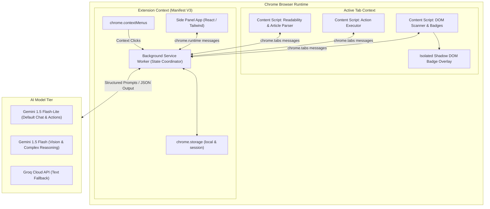
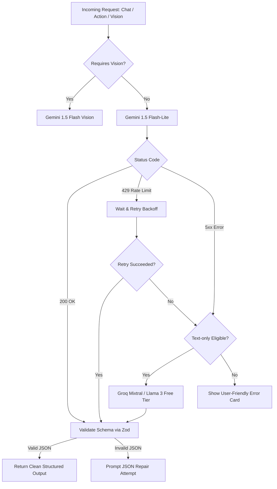
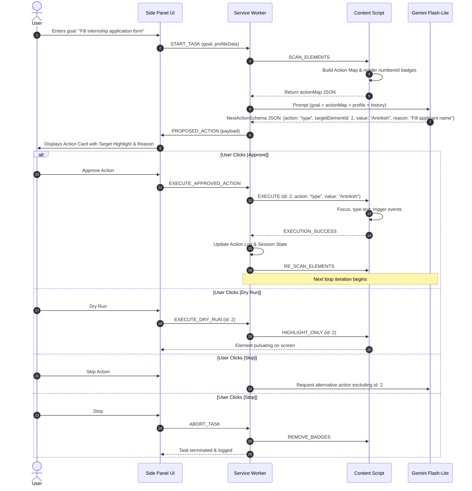

# Architecture Specification: ASKbro AI Browser Agent

> **Version:** 1.0.0  
> **Status:** Approved / Baseline Architecture  
> **Target Platform:** Google Chrome (Desktop) — Manifest V3  
> **Reference Document:** [ProblemStatement.md](file:///c:/Users/antri/OneDrive/Desktop/ASKbro-AI%20Browser/ProblemStatement.md)

---

## 1. System Overview & Vision

**ASKbro** is a lightweight, high-agency Chrome Side Panel AI assistant designed to bridge the gap between AI comprehension and user-controlled browser action. Unlike fully autonomous bots that risk unintended actions or data leakage, ASKbro operates strictly on a **Human-in-the-Loop (HITL)** architecture: it reads page context, structures interactive elements into an optimized action map, proposes one discrete step at a time, and executes **only after explicit human authorization**.

```
+-----------------------------------------------------------------------------------+
|                                  USER BROWSER                                     |
|                                                                                   |
|  +------------------------------------+  +-------------------------------------+  |
|  |           Active Web Page          |  |       ASKbro Side Panel (UI)        |  |
|  |                                    |  |                                     |  |
|  |  [ Badge 1 ] Login Button          |  |  +-------------------------------+  |  |
|  |  [ Badge 2 ] Search Input          |  |  | Chat / Summaries / Skills     |  |  |
|  |  [ Badge 3 ] Submit Form           |  |  +-------------------------------+  |  |
|  |                                    |  |  | Proposed Action:              |  |  |
|  |  * Highlighting active target      |  |  | "Type 'Intern' into [2]"      |  |  |
|  |  * Safety blocks on sensitive fields| |  | [ Approve ] [ Skip ] [ Stop ] |  |  |
|  +-----------------+------------------+  +------------------+------------------+  |
|                    ^                                        ^                     |
|                    | DOM Scan / Action Execution            | User Decisions      |
|                    v                                        v                     |
|  +-----------------------------------------------------------------------------+  |
|  |                     Background Service Worker (MV3)                         |  |
|  |       Router | State Preservation | Screenshot Capture | Alarms / Storage   |  |
|  +---------------------------------------+-------------------------------------+  |
+------------------------------------------|----------------------------------------+
                                           | Prompt + Action Map (Sanitized)
                                           v
                             +---------------------------+
                             |   AI Model Provider Tier  |
                             |  - Gemini 1.5 Flash-Lite  |
                             |  - Gemini 1.5 Flash       |
                             |  - Groq Free (Fallback)   |
                             +---------------------------+
```

---

## 2. Core Architectural Principles

1. **Deterministic Safety over Model Trust**: Safety rules (blocking banking URLs, withholding password/card fields, halting on sensitive domains) are enforced purely via client-side code checks, not via LLM system prompts.
2. **Strict Human-in-the-Loop (HITL)**: Every single computer-use mutation (`click`, `type`, `select`, `submit`) requires an active user click (`Approve`) in the Side Panel UI. Dry-run highlighting allows the user to preview target elements prior to commitment.
3. **Local-First & Zero Telemetry**: Gemini API keys, local profile information, one-click skills, and chat histories live exclusively inside `chrome.storage.local`.
4. **Resilience to MV3 Service Worker Hibernation**: In Chrome Manifest V3, background workers terminate after ~30s of inactivity. The agent session and multi-step state machine are continuously persisted to `chrome.storage.session`/`local` so hydration is instantaneous upon wake-up.
5. **Free-Tier Cost Optimization**: Default to lightweight, fast models (Gemini Flash-Lite), escalate to multimodal reasoning (Gemini Flash) strictly for visual screenshots, and fallback gracefully to Groq text endpoints upon rate limits (HTTP 429).

---

## 3. High-Level Component Topology



---

## 4. Subsystem Deep Dive & Component Specifications

### 4.1 Side Panel Subsystem (`/src/sidepanel`)
The Side Panel serves as the single pane of glass for all user interactions.

- **Technology**: React 18, TypeScript, Tailwind CSS, Lucide Icons.
- **Key Modules**:
  - `ChatContainer`: Streaming response renderer, markdown support (KaTeX math, code blocks), language toggle (English $\leftrightarrow$ Hinglish).
  - `ActionApprovalCard`: Visual card displaying proposed action type, target badge number, target element snippet, reason, and interactive controls (`Approve`, `Skip`, `Stop`, `Dry Run Toggle`).
  - `VisionInspector`: Cropping and preview canvas for screenshots before submitting to Gemini Flash.
  - `ProfileSettingsModal`: Form management for local user profile (Name, College, Skills, Links, Preferred Tone).
  - `SkillsManager`: Library of reusable prompts (e.g., "Exam Notes", "Draft Polite Reply", "Autofill from Profile") with JSON Import/Export capabilities.
  - `ActionLogView`: Audit trail showing timestamps, proposed actions, reasons, and user decisions (Approved / Skipped / Rejected).

### 4.2 Background Service Worker Subsystem (`/src/background`)
The central event orchestrator in Manifest V3.
- **Event Handling**:
  - `chrome.sidePanel.setPanelBehavior`: Opens side panel upon clicking the extension action icon.
  - `chrome.contextMenus`: Right-click menu handlers (`Explain this`, `Translate`, `Draft a reply`) routing directly into the active side panel view.
  - `chrome.tabs.captureVisibleTab`: Captures visible viewport as PNG Data URL for visual Q&A.
- **State Machine & Hibernation Recovery**:
  - Stores active task status (`IDLE`, `PLANNING`, `AWAITING_APPROVAL`, `EXECUTING`, `COMPLETED`, `PAUSED`).
  - Writes current agent step, pending action proposal, and tab ID into `chrome.storage.session` prior to any asynchronous wait.

### 4.3 Content Script & In-Page Engine (`/src/content`)
Injected into target web pages to inspect and interact with the DOM without corrupting the host page layout.

#### A. Reader & Extractor (`reader.ts`)
- Leverages `@mozilla/readability` to extract main article text, stripped of ads, navbars, and cookie banners.
- YouTube parser: Detects `youtube.com/watch` URLs, scrapes title, description, and public chapter timestamps from the player DOM.

#### B. Interactive Element Scanner & Numbered Action Map (`scanner.ts`)
- Recursively traverses DOM for actionable nodes:
  `button`, `a[href]`, `input`, `textarea`, `select`, `[role="button"]`, `[role="link"]`, `[tabindex]:not([tabindex="-1"])`.
- Filters out hidden, zero-sized, or off-screen elements via `getBoundingClientRect()`.
- Generates a **Compact Action Map JSON**:
  ```json
  [
    {"id": 1, "tag": "input", "type": "text", "name": "search", "placeholder": "Search jobs...", "aria": "Search input"},
    {"id": 2, "tag": "button", "text": "Apply Now", "classes": "btn-primary"}
  ]
  ```
- **Isolated Overlay Container**: Injects a non-intrusive container using `attachShadow({mode: 'closed'})` to render numbered badge overlays pinned to element coordinates without inheriting or breaking page CSS.

#### C. Execution Engine (`executor.ts`)
- Executes browser operations strictly upon message from the service worker:
  - `click(elementId)`: Scrolls element into viewport (`scrollIntoView({behavior: 'smooth', block: 'center'})`), pulses red/green outline, fires synthetic `pointerdown`, `mousedown`, `click` events.
  - `type(elementId, text)`: Focuses input, clears existing value if required, dispatches `input` and `change` events with proper keyboard events.
  - `select(elementId, value)`: Modifies option and dispatches change event.
  - `scroll(direction, amount)`: Window scroll.
- **Dry-Run Mode**: Only scrolls to and flashes an orange highlight badge around the element, returning success without clicking or typing.

---

### 4.4 Safety & Guardrails Engine (`/src/safety`)
Enforced strictly by **deterministic TypeScript code** before any prompt is assembled or action dispatched.

```
+-----------------------------------------------------------------------------+
|                             SAFETY PIPELINE                                 |
|                                                                             |
|  [Target Page URL]                                                          |
|         │                                                                   |
|         ▼                                                                   |
|  [URL Blacklist Check]  ──(Match: bank, upi, pay, account, checkout)──►  [BLOCK]
|         │ (Safe)                                                            |
|         ▼                                                                   |
|  [Element Attribute Inspection]                                             |
|         │                                                                   |
|         ├── type="password" ──────────────────────────────────────────►  [BLOCK]
|         ├── autocomplete="cc-number" / "one-time-code" ───────────────►  [BLOCK]
|         └── name/id regex (*otp*, *cvv*, *creditcard*, *ssn*) ────────►  [BLOCK]
|         │ (Safe)                                                            |
|         ▼                                                                   |
|  [Consequential Action Detection]                                           |
|         │                                                                   |
|         └── Button text / ARIA matching ("Submit", "Pay Now", "Delete")     |
|                   │                                                         |
|                   ├── Yes ──► Require Secondary "High-Risk Confirmation" Modal
|                   └── No  ──► Standard HITL Approval Card                   |
+-----------------------------------------------------------------------------+
```

1. **Restricted Domain Classifier (`domainGuard.ts`)**:
   - Regex matches against banking portals, UPI gateways, checkout paths (`*bank*`, `*paytm*`, `*phonepe*`, `*razorpay*`, `*checkout*`, `*billing*`).
   - If matched, Computer-Use actions are disabled instantly; side panel informs user.
2. **Sensitive Field Blocker (`fieldGuard.ts`)**:
   - Blocks automated typing if `input.type === 'password'`, `input.autocomplete` contains `cc-*` or `one-time-code`, or `name`/`id` matches `/(otp|cvv|password|token|pin|card)/i`.
3. **Consequential Action Interceptor (`consequentialGuard.ts`)**:
   - Scans target text for keywords (`submit`, `delete`, `pay`, `purchase`, `send email`, `confirm transfer`).
   - Upgrades approval dialog to a high-contrast warning card requiring dual confirmation.
4. **Instant Emergency Kill Switch**:
   - A sticky header "STOP AGENT" button in the side panel aborts any in-flight loop, unbinds content script listeners, and purges injected DOM badges.

---

### 4.5 AI Integration & Fallback Strategy (`/src/services/ai`)



- **Strict Structured Outputs**: All agent decisions use JSON schema enforcement with Zod:
  ```typescript
  export const NextActionSchema = z.object({
    action: z.enum(['click', 'type', 'select', 'scroll', 'done']),
    targetElementId: z.number().nullable(),
    value: z.string().nullable(),
    reason: z.string().max(120),
    isConsequential: z.boolean()
  });
  ```

---

## 5. End-to-End Sequence Diagrams

### 5.1 One-Step-at-a-Time Approval Loop (Computer Use)



---

## 6. Project Directory Structure

```
ASKbro-AI Browser/
├── ProblemStatement.md          # Project requirements and specification
├── architecture.md              # System architecture (this document)
├── package.json                 # Dependencies & build scripts
├── tsconfig.json                # TypeScript compiler configuration
├── vite.config.ts               # Vite build setup for Chrome Extension
├── manifest.json                # Manifest V3 configuration
├── public/
│   ├── icons/                   # Extension icons (16px, 48px, 128px)
│   └── landing/                 # GitHub Pages landing site assets
└── src/
    ├── background/
    │   ├── index.ts             # Service worker entry point
    │   ├── menuHandler.ts       # Context menu actions
    │   ├── stateManager.ts      # Session & persistent state across worker hibernation
    │   └── captureHandler.ts    # chrome.tabs screenshot coordinator
    ├── content/
    │   ├── index.ts             # Content script bootstrapping
    │   ├── reader.ts            # Readability & YouTube extractor
    │   ├── scanner.ts           # Interactive element detection & numbering
    │   ├── badges.ts            # Shadow-DOM badge overlay injector
    │   └── executor.ts          # Safe synthetic action dispatcher
    ├── sidepanel/
    │   ├── index.html           # Side panel root HTML
    │   ├── index.tsx            # React application mount
    │   ├── components/
    │   │   ├── Chat/            # Page chat & Hinglish toggle
    │   │   ├── Agent/           # ActionApprovalCard, ActionLog, DryRunControls
    │   │   ├── Vision/          # Screenshot crop & inspector
    │   │   ├── Skills/          # One-click skills list & import/export
    │   │   └── Settings/        # API key & Local Profile inputs
    │   └── hooks/               # useChromeStorage, useAgentLoop
    ├── services/
    │   ├── ai/
    │   │   ├── gemini.ts        # Gemini Flash-Lite & Flash clients
    │   │   ├── groq.ts          # Groq fallback client
    │   │   ├── promptBuilder.ts # Grounding & structured prompt constructors
    │   │   └── schemas.ts       # Zod schemas for JSON outputs
    │   ├── safety/
    │   │   ├── domainGuard.ts   # URL / Banking / UPI check
    │   │   ├── fieldGuard.ts    # Password / OTP / Card input blocker
    │   │   └── rules.ts         # High-risk action detection
    │   └── storage/
    │       ├── profileStore.ts  # Local profile CRUD
    │       ├── skillsStore.ts   # Prompt recipe import/export
    │       └── historyStore.ts  # Audit log recorder
    ├── types/
    │   ├── action.ts            # Action map, badge, and step schemas
    │   ├── messages.ts          # Strongly typed chrome.runtime messages
    │   └── profile.ts           # User profile & skill definitions
    └── utils/
        ├── logger.ts            # Scoped console logger
        └── domUtils.ts          # Bounding box & visibility heuristics
```

---

## 7. Security, Privacy & Threat Modeling

| Threat Vector | Mitigation Strategy |
| :--- | :--- |
| **Prompt Injection from Web Page Content** | Extracted page content and Action Maps are wrapped in strict delimiters (`<page_context>` / `<action_map>`). System instructions dictate that user requests take precedence, and model output is validated against strict JSON schema before execution. |
| **Accidental Financial / Auth Mutation** | `domainGuard.ts` deterministically halts execution on known payment and authentication gateways. `fieldGuard.ts` prevents any synthetic input events into password or OTP inputs. |
| **API Key Exposure in Public Repository** | API keys are entered strictly via the Side Panel Settings UI and saved to `chrome.storage.local`. No `.env` with keys is committed; `.gitignore` includes sensitive artifacts. |
| **DOM Pollution / Style Bleed** | Numbered badges and visual highlights are mounted inside an isolated Shadow DOM (`mode: 'closed'`), guaranteeing that host page stylesheets cannot tamper with badges, and badge styles cannot alter the host page. |
| **Service Worker Hibernation Data Loss** | Every state transition in the Agent Loop writes a checkpoint to `chrome.storage.session`. When the service worker awakens, it rehydrates the active step seamlessly. |

---

## 8. Build & Implementation Roadmap (Vertical Slices)

Aligned directly with the 4-week development plan:

```
[ Week 1 - The Eyes: Read the Web ]
├── Slice 1: Extension Shell (Manifest V3, Side Panel, Settings UI for API Key)
├── Slice 2: Gemini API Integration (Flash-Lite text call with error boundaries)
├── Slice 3: Readability.js Article Extraction (TL;DR, 5 Points, Next Steps)
├── Slice 4: Public YouTube Summariser with Timestamps
└── Slice 5: Language Switcher (English <-> Hinglish output generation)

[ Week 2 - The Brain: Understand the Page & Screen ]
├── Slice 6: Grounded Page Chat (Grounded prompt strictly in extracted context)
├── Slice 7: Context Menu AI Actions (Explain, Translate, Draft Reply)
├── Slice 8: Screenshot-and-Ask (chrome.tabs.captureVisibleTab + Gemini Flash Vision)
└── Slice 9: Free-Tier Resilience & Fallback (HTTP 429 retry + Groq fallback)

[ Week 3 - The Hands: Act With User Approval ]
├── Slice 10: Interactive Element Scanner & Shadow DOM Numbered Badges
├── Slice 11: Structured JSON Action Generator ("Find it for me" + strict Zod schema)
├── Slice 12: Human-in-the-Loop Agent Loop (Approve / Skip / Stop / Step Limit)
└── Slice 13: Dry-Run Mode & Persistent Action Log across Worker Hibernation

[ Week 4 - Memory, Safety, and Shipping ]
├── Slice 14: Local Profile Memory (chrome.storage.local for autofill & tone)
├── Slice 15: Reusable One-Click Skills (Import/Export JSON recipes)
├── Slice 16: Deterministic Safety Rails (Domain blacklist, Password/OTP locks)
└── Slice 17: Packaging & Release (GitHub Release ZIP, Clean README, Landing Page)
```

