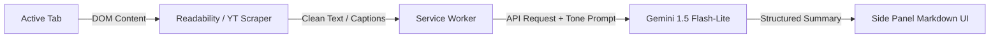
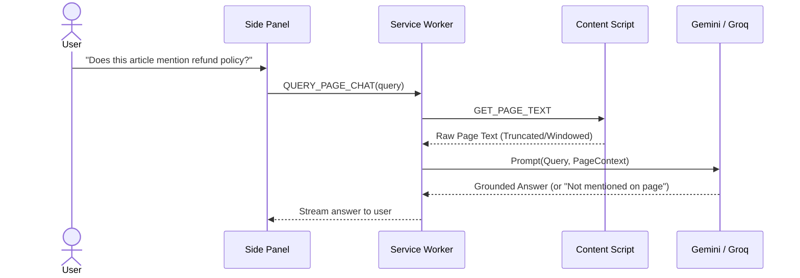
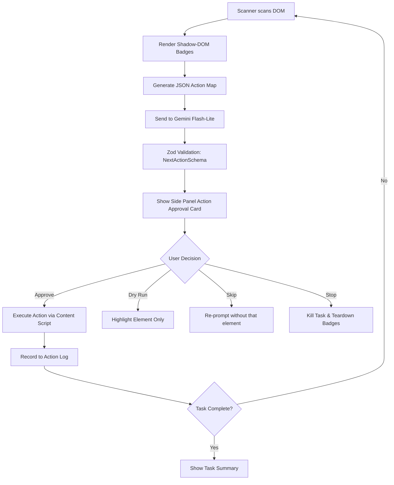
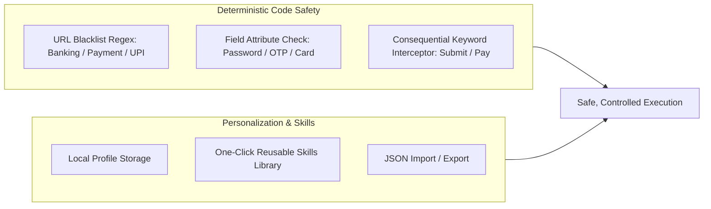

# Phase-Wise Implementation Plan: ASKbro AI Browser Agent

> **Project:** ASKbro — Chrome Side-Panel AI Agent  
> **Target Platform:** Google Chrome (Desktop) — Manifest V3  
> **References:** [ProblemStatement.md](file:///c:/Users/antri/OneDrive/Desktop/ASKbro-AI%20Browser/ProblemStatement.md) | [architecture.md](file:///c:/Users/antri/OneDrive/Desktop/ASKbro-AI%20Browser/architecture.md)  
> **Development Methodology:** Vertical Slices (Smallest testable unit $\rightarrow$ verified on real pages $\rightarrow$ next slice)

---

## Overview & Milestone Roadmap

```
+---------------------------------------------------------------------------------------+
|                                    ASKbro ROADMAP                                     |
|                                                                                       |
|  [Phase 0]  Environment, Tooling & Project Skeleton (Day 1)                           |
|      │                                                                                |
|      ▼                                                                                |
|  [Phase 1]  Week 1 — The Eyes: Read the Web (Days 2 - 7)                              |
|      │      Extension Shell • Gemini Client • Readability • YouTube • Hinglish        |
|      ▼                                                                                |
|  [Phase 2]  Week 2 — The Brain: Understand Page & Screen (Days 8 - 14)                |
|      │      Grounded Chat • Context Menus • Screenshot Vision • Fallbacks             |
|      ▼                                                                                |
|  [Phase 3]  Week 3 — The Hands: Act With Approval (Days 15 - 21)                      |
|      │      DOM Scanner • Action Badges • Structured JSON • HITL Loop • Dry Run       |
|      ▼                                                                                |
|  [Phase 4]  Week 4 — Memory, Safety & Shipping (Days 22 - 28)                         |
|             Local Profile • Saved Skills • Code-Level Safety • GitHub Release ZIP     |
+---------------------------------------------------------------------------------------+
```

---

## Phase 0: Environment Setup, Tooling & Project Skeleton

### Objective
Initialize the repository, configure modern Vite + TypeScript build pipelines for Chrome Manifest V3, and verify seamless hot/fast reload in `chrome://extensions`.

### Task Breakdown

#### Task 0.1: Package & Workspace Setup
- Initialize `package.json` with scripts:
  - `dev`: Vite in watch mode.
  - `build`: Production build with TypeScript checking (`tsc && vite build`).
  - `package`: Zips the `dist/` directory into `release.zip` for testing and distribution.
- Dependencies:
  - **Runtime**: `react`, `react-dom`, `@mozilla/readability`, `lucide-react`, `zod`, `clsx`, `tailwind-merge`.
  - **DevDependencies**: `typescript`, `vite`, `@vitejs/plugin-react`, `@crxjs/vite-plugin` (or `@types/chrome` + custom multi-entry rollup), `tailwindcss`, `postcss`, `autoprefixer`.

#### Task 0.2: Manifest V3 Configuration
- Create `manifest.json`:
  ```json
  {
    "manifest_version": 3,
    "name": "ASKbro - AI Browser Agent",
    "version": "1.0.0",
    "description": "Chrome side-panel AI agent that understands web pages and acts under human control.",
    "permissions": [
      "sidePanel",
      "activeTab",
      "scripting",
      "storage",
      "contextMenus",
      "tabs"
    ],
    "action": {
      "default_title": "Open ASKbro"
    },
    "side_panel": {
      "default_path": "src/sidepanel/index.html"
    },
    "background": {
      "service_worker": "src/background/index.ts",
      "type": "module"
    },
    "icons": {
      "16": "public/icons/icon-16.png",
      "48": "public/icons/icon-48.png",
      "128": "public/icons/icon-128.png"
    }
  }
  ```

#### Task 0.3: Base Directory Structure Setup
- Establish project folders:
  - `src/background/`
  - `src/content/`
  - `src/sidepanel/`
  - `src/services/{ai, safety, storage}/`
  - `src/types/`
  - `src/utils/`

### Verification & Checkpoint
1. Run `npm run build`. Confirm `dist/` is created without TypeScript or bundler errors.
2. Open `chrome://extensions`, enable **Developer mode**, click **Load unpacked**, and select `dist/`.
3. Click the extension toolbar icon. Confirm the side panel opens displaying "ASKbro ready".

---

## Phase 1: Week 1 — The Eyes: Read the Web

### Objective
Build the foundation allowing ASKbro to extract, process, and summarize articles and public YouTube videos in English or Hinglish with zero crashes.



### Vertical Slices & Tasks

#### Slice 1.1: Settings & API Key Storage
- **Files**:
  - `src/services/storage/settingsStore.ts`
  - `src/sidepanel/components/Settings/ApiKeySettings.tsx`
- **Details**:
  - Store `geminiApiKey` and `groqApiKey` securely inside `chrome.storage.local`.
  - Provide input masking, test connection button (fires a test ping to Gemini), and validation feedback.
  - Ensure keys are never stored in source code or sent to external telemetry.

#### Slice 1.2: Gemini Client Service
- **Files**:
  - `src/services/ai/gemini.ts`
  - `src/types/ai.ts`
- **Details**:
  - Implement typed caller for Gemini 1.5 Flash-Lite (`v1beta/models/gemini-1.5-flash-lite:generateContent`).
  - Support streaming responses using Server-Sent Events (`streamGenerateContent`) when available.
  - Implement system instructions enforcing structured summarization format.

#### Slice 1.3: Content Script Article Extractor
- **Files**:
  - `src/content/reader.ts`
  - `src/types/messages.ts`
- **Details**:
  - Content script listens for `EXTRACT_PAGE_CONTENT` message.
  - Clones document DOM and applies `@mozilla/readability`.
  - Extracts title, author, clean text body, and estimated reading time.
  - Gracefully falls back to body text if Readability returns null.

#### Slice 1.4: Structured Summarization Engine
- **Files**:
  - `src/services/ai/promptBuilder.ts`
  - `src/sidepanel/components/Summary/SummaryCard.tsx`
- **Details**:
  - Structured output prompt generating:
    1. **TL;DR**: Exactly one concise sentence.
    2. **5 Key Takeaways**: Bullet points with bold lead-ins.
    3. **Actionable Next Steps / What to do next**: 2–3 concrete suggestions.

#### Slice 1.5: Public YouTube Video Summarizer
- **Files**:
  - `src/content/youtube.ts`
- **Details**:
  - Detect `window.location.hostname.includes("youtube.com") && window.location.pathname === "/watch"`.
  - Scrape video title, channel, description, and available chapters/timestamps from `#description` or player DOM.
  - Send to Gemini with prompt requesting chapter-wise notes and clickable timestamps (`mm:ss`). Clicking timestamps in the side panel seeks the video (`videoElement.currentTime = seconds`).

#### Slice 1.6: English / Hinglish Language Switcher
- **Files**:
  - `src/sidepanel/components/Common/LanguageToggle.tsx`
- **Details**:
  - Persistent state in `chrome.storage.local`: `"en" | "hinglish"`.
  - In Hinglish mode, instruct the prompt: *"Summarise the content in colloquial Hinglish (Hindi written in Roman English script, widely used in India, e.g., 'Yeh video batata hai ki...') while keeping technical terms intact."*

### Phase 1 Acceptance Criteria
- [x] Loads unpacked without warnings in Chrome.
- [x] Side panel displays settings and persists API key in `chrome.storage.local`.
- [x] News/blog articles (e.g., Wikipedia, Medium, TechCrunch) summarize accurately into TL;DR + 5 Points + Next Steps.
- [x] YouTube video pages produce timestamped chapter notes that seek the video on click.
- [x] Language toggle instantly switches output style between English and conversational Hinglish.

---

## Phase 2: Week 2 — The Brain: Understand Page & Screen

### Objective
Turn the side panel into a grounded conversational assistant that can reason over active DOM text, inspect screenshots, support right-click AI actions, and handle rate limits with automatic fallbacks.



### Vertical Slices & Tasks

#### Slice 2.1: Grounded Page Chat
- **Status**: Complete (Verified with 11 automated unit tests)
- **Files**:
  - `src/sidepanel/components/Chat/ChatView.tsx`
  - `src/sidepanel/components/Chat/index.ts`
  - `src/services/ai/groundedChat.ts`
  - `src/sidepanel/App.tsx`
  - `src/background/index.ts`
  - `tests/groundedChat.test.ts`
- **Details**:
  - Chat interface maintaining session message history (`user` and `model` alternating turns).
  - Injects full or chunked page context inside `<page_context>` XML tags with sanitization defense against injection breakouts.
  - **Grounding Rule**: Explicit instruction to state *"The current page does not provide information about..."* if answer is not in the text, avoiding hallucinations.
  - Supports both English and colloquial Roman-script Hinglish modes.
  - Real-time SSE streaming with typing cursor, stop button, auto-scrolling, and one-click copy.
  - Suggested contextual starter questions generated dynamically based on active page metadata.
  - Message-passing support via `QUERY_PAGE_CHAT` in Service Worker.

#### Slice 2.2: Context Menu AI Actions (Explain, Translate, Draft)
- **Status**: Complete (Verified with 14 automated unit tests)
- **Files**:
  - `src/background/menuHandler.ts`
  - `src/services/ai/contextMenuActions.ts`
  - `src/sidepanel/components/Actions/ContextMenuActionCard.tsx`
  - `src/sidepanel/components/Actions/index.ts`
  - `src/sidepanel/App.tsx`
  - `tests/contextMenu.test.ts`
- **Details**:
  - Registered right-click context menus via `chrome.contextMenus.create`:
    - `askbro-explain`: "Explain this with ASKbro"
    - `askbro-translate`: "Translate to Hindi/Hinglish"
    - `askbro-reply`: "Draft a reply to this"
  - When triggered, captures selected text via `info.selectionText`, activates the side panel via `chrome.sidePanel.open`, and stages payload in storage for reliable cold-start pickup.
  - Broadcasts `CONTEXT_MENU_ACTION` runtime message for immediate processing in already-open side panels.
  - Dedicated `ContextMenuActionCard` provides real-time streaming, quick action switching (Explain / Translate / Draft), tone customization (Professional, Direct, Casual), English & Hinglish toggling, and one-click copy to clipboard.

#### Slice 2.3: Visual Screen Understanding ("Screenshot-and-Ask")
- **Status**: Complete (Verified with 13 automated unit tests)
- **Files**:
  - `src/background/captureHandler.ts`
  - `src/sidepanel/components/Vision/ScreenshotModal.tsx`
  - `src/sidepanel/components/Vision/index.ts`
  - `src/services/ai/vision.ts`
  - `src/sidepanel/App.tsx`
  - `src/sidepanel/components/Chat/ChatView.tsx`
  - `tests/vision.test.ts`
- **Details**:
  - Trigger `chrome.tabs.captureVisibleTab(null, {format: 'png'})`.
  - Pass the PNG Data URL into the Side Panel with a lightweight crop/inspector tool.
  - Send image + question payload to **Gemini 1.5 Flash** (multimodal endpoint).
  - Handles charts, visual tables, error callouts, and layout diagrams.

#### Slice 2.4: Free-Tier Resilience & Fallback Engine
- **Status**: Complete (Verified with 15 automated unit tests)
- **Files**:
  - `src/services/ai/rateLimiter.ts`
  - `src/services/ai/groq.ts`
  - `src/services/ai/index.ts`
  - `src/services/ai/gemini.ts`
  - `src/services/ai/groundedChat.ts`
  - `src/services/ai/contextMenuActions.ts`
  - `src/sidepanel/components/Common/RateLimitBanner.tsx`
  - `src/sidepanel/components/Common/index.ts`
  - `src/sidepanel/components/Chat/ChatView.tsx`
  - `src/sidepanel/components/Summary/SummaryCard.tsx`
  - `src/sidepanel/components/Actions/ContextMenuActionCard.tsx`
  - `src/sidepanel/components/Vision/ScreenshotModal.tsx`
  - `src/sidepanel/App.tsx`
  - `tests/rateLimiter.test.ts`
- **Details**:
  - Intercepts HTTP 429 / Quota Exceeded / Resource Exhausted errors reliably across Gemini and Groq.
  - Implements exponential backoff (`[1000, 2000, 4000]` ms: 1s $\rightarrow$ 2s $\rightarrow$ 4s) with AbortSignal cancellation support.
  - If retry fails or quota is exhausted for text queries, automatically falls back to **Groq Cloud API** (`mixtral-8x7b-32768` / `llama-3.3-70b-versatile` / `llama-3.1-8b-instant` on free tier).
  - Handles non-streaming and Server-Sent Events (SSE) streaming fallback seamlessly without dropping user connection.
  - If multimodal or all providers fail, displays a resilient, non-crashing banner: *"Daily free-tier quota reached. Retry in X seconds or configure fallback key."* with live countdown, one-click settings shortcut, and instant retry.
  - Global `RateLimitTracker` maintains cooldown timers across providers.

### Phase 2 Acceptance Criteria
- [x] User can ask questions about the open page; answers cite page facts and decline unknown facts.
- [x] Right-clicking highlighted text offers "Explain", "Translate", and "Draft", and injects results into the side panel.
- [x] "Capture Screen" button snaps active tab, allows user prompt, and interprets charts/visual content accurately.
- [x] Forcing an HTTP 429 response triggers retry and automatic Groq fallback without UI crashes.

---

## Phase 3: Week 3 — The Hands: Act With User Approval

### Objective
Implement controlled computer-use capabilities: scanning actionable elements, rendering non-destructive numbered badges, producing structured JSON actions, and executing them **strictly after human approval**.



### Vertical Slices & Tasks

#### Slice 3.1: Interactive Element Scanner & Shadow DOM Badges
- **Files**:
  - `src/content/scanner.ts`
  - `src/content/badges.ts`
- **Details**:
  - Traverses interactive nodes: `button`, `a`, `input`, `textarea`, `select`, `[role="button"]`, `[tabindex]`.
  - Filters out hidden (`display: none`, `visibility: hidden`, `opacity: 0`, width/height < 5px).
  - Assigns unique integer IDs: `1, 2, 3...`.
  - Injects a closed Shadow DOM overlay `#askbro-badge-root` containing floating badge pills positioned via `getBoundingClientRect()`.
  - Re-calculates on window `resize` and `scroll`.

#### Slice 3.2: Action Map JSON Generation & "Find It For Me"
- **Files**:
  - `src/services/ai/actionMap.ts`
- **Details**:
  - Converts DOM elements into clean, compact representation:
    ```json
    {"id": 4, "type": "button", "text": "Submit Application"}
    ```
  - Feature: User asks *"Where do I upload my resume?"*
  - LLM returns target element ID `{"targetElementId": 4, "reason": "File upload input"}`.
  - ASKbro smoothly scrolls the page and pulses a cyan highlight on badge #4 without clicking.

#### Slice 3.3: Strict JSON Action Engine (Zod Schema) [DONE]
- **Files**:
  - `src/services/ai/schemas.ts`
  - `tests/schemas.test.ts`
- **Details**:
  - Enforce JSON format using Gemini structured output schemas / system prompt:
    ```typescript
    export const ActionStepSchema = z.object({
      action: z.enum(['click', 'type', 'select', 'scroll', 'done']),
      targetId: z.number().nullable(),
      value: z.string().nullable(),
      reason: z.string(),
      isConsequential: z.boolean()
    });
    ```
  - Parse and validate every LLM response before letting it touch the UI.

#### Slice 3.4: Human-in-the-Loop (HITL) Action Approval Card [DONE]
- **Files**:
  - `src/sidepanel/components/Agent/ActionCard.tsx`
  - `src/sidepanel/components/Agent/AgentControls.tsx`
  - `src/sidepanel/components/Agent/AgentView.tsx`
  - `tests/actionCard.test.ts`
- **Details**:
  - Renders the proposed step:
    - **Action**: `CLICK` / `TYPE` / `SELECT` / `SCROLL`
    - **Target Element**: Number badge + element description
    - **Input Value**: Show typed text or chosen option
    - **Reasoning**: One-line rationale from LLM
  - Buttons:
    - `Approve`: Dispatches action execution to content script.
    - `Dry Run`: Flashes element outline on the page without performing click/type.
    - `Skip`: Skips this element and requests an alternative step.
    - `Stop`: Immediate abort.
  - Step counter: Configurable maximum steps (default: 10) to prevent loops.

#### Slice 3.5: Content Script Action Executor [DONE]
- **Files**:
  - `src/content/executor.ts`
  - `src/content/index.ts`
  - `tests/executor.test.ts`
- **Details**:
  - Safely simulates native user interactions:
    - `click`: Focuses $\rightarrow$ dispatches `pointerdown`, `mousedown`, `pointerup`, `mouseup`, `click`.
    - `type`: Clears input $\rightarrow$ sets `.value` (with React prototype setter support) $\rightarrow$ dispatches `input` and `change` events.
    - `select`: Updates selected index (matches by value, text label, or numeric index) $\rightarrow$ dispatches `change` and `input` events.
    - `scroll`: Smooth scroll by offset ("down", "up", "top", "bottom", or numeric px) or scrolls target element into view $\rightarrow$ repositions badges.
    - `done`: Completes task.
  - Listens for `EXECUTE_ACTION` message from side panel/background and responds asynchronously with `ExecuteActionResponse`.

#### Slice 3.6: Worker Hibernation & Session State Persistence [DONE]
- **Files**:
  - `src/background/stateManager.ts`
  - `src/background/index.ts`
  - `src/sidepanel/components/Agent/AgentView.tsx`
  - `src/types/action.ts`
  - `src/types/messages.ts`
  - `src/services/storage/index.ts`
  - `tests/stateManager.test.ts`
- **Details**:
  - Write agent execution progress to `chrome.storage.session` after every step.
  - If the service worker sleeps during user contemplation on the approval card, restoring the side panel re-reads the pending state instantly.
  - Record each step into an audit log (`chrome.storage.local`).
  - Keep-alive heartbeat channel while awaiting approval or executing to prevent premature worker termination.
  - Export audit log as formatted JSON for auditing and inspection.

### Phase 3 Acceptance Criteria
- [x] Numbered badges overlay all actionable elements without breaking page layout.
- [x] "Find it for me" correctly scrolls to and highlights target elements from natural language prompts.
- [x] No browser action occurs without explicit click on `Approve`.
- [x] `Dry Run` outlines the element without triggering any input change or navigation.
- [x] Multi-step tasks successfully complete on practice test pages (e.g., job application form, search & filter).

---

## Phase 4: Week 4 — Memory, Safety, Packaging & Shipping

### Objective
Add user profile memory for automated form drafts, enable reusable one-click skills with import/export, establish deterministic safety guardrails, and prepare clean public release packages.



### Vertical Slices & Tasks

#### Slice 4.1: Local Profile Memory [DONE]
- **Files**:
  - `src/services/storage/profileStore.ts`
  - `src/sidepanel/components/Settings/ProfileView.tsx`
  - `src/sidepanel/components/Settings/index.ts`
  - `src/sidepanel/components/Settings/ApiKeySettings.tsx`
  - `src/types/profile.ts`
  - `src/services/storage/index.ts`
  - `src/services/ai/schemas.ts`
  - `src/sidepanel/components/Agent/AgentView.tsx`
  - `tests/profile.test.ts`
- **Details**:
  - Fields stored locally:
    - Full Name, Email, Phone, College / University, Major, Graduation Year, Portfolio / LinkedIn / GitHub URLs, Skills List, Preferred Writing Tone.
  - Integration: When user requests *"Fill this form from my profile"*, the action planner maps form fields directly to profile fields.

#### Slice 4.2: One-Click Reusable Skills Engine [DONE]
- **Status**: Complete (Verified with 22 automated unit tests)
- **Files**:
  - `src/types/skills.ts`
  - `src/services/storage/skillsStore.ts`
  - `src/services/ai/skillExecutor.ts`
  - `src/sidepanel/components/Skills/SkillCard.tsx`
  - `src/sidepanel/components/Skills/SkillModal.tsx`
  - `src/sidepanel/components/Skills/SkillExecutionDrawer.tsx`
  - `src/sidepanel/components/Skills/SkillsLibrary.tsx`
  - `src/sidepanel/components/Skills/index.ts`
  - `src/sidepanel/App.tsx`
  - `tests/skillsStore.test.ts`
- **Details**:
  - **Pre-packaged Starter Skills**:
    1. **Exam Notes** (`skill-exam-notes`): Structured summary focusing on key terms, definitions, and equations.
    2. **Explain in Hinglish** (`skill-explain-hinglish`): Conversational breakdown for quick comprehension in Roman Hinglish with desi analogies.
    3. **Reply to this Politely** (`skill-reply-politely`): Professional draft response to selected emails or discussion posts.
    4. **Fill from Profile** (`skill-fill-profile`): Autofills known input fields from local memory under human supervision.
  - **Skill Creation & Editing Modal**:
    - Name, description, action workflow target, icon picker, system prompt instructions, and tag management.
    - Strict runtime validation via Zod (`SkillDefinitionSchema`).
  - **Export & Import Engine**:
    - Portable JSON bundle export compliant with `SkillExportBundleSchema`.
    - Flexible JSON import supporting full bundles, array format, and single skill objects with merge and replace strategies.
    - Starter skills factory reset while preserving custom user-created skills.
  - **Execution & Navigation**:
    - One-click run execution directly from sidepanel.
    - Form autofill skills seamlessly route to the Agent view with goal `Fill this form from my profile`.
    - Generative skills extract active tab content, apply prompt injection defenses, and stream results via Gemini with Groq fallback.
    - One-click clipboard copy and seamless "Continue in Page Chat" workflow.

#### Slice 4.3: Deterministic Code Safety Guardrails [DONE]
- **Status**: Complete (Verified with 22 automated unit tests)
- **Files**:
  - `src/services/safety/domainGuard.ts`
  - `src/services/safety/fieldGuard.ts`
  - `src/services/safety/consequentialGuard.ts`
  - `src/services/safety/index.ts`
  - `src/content/scanner.ts`
  - `src/content/executor.ts`
  - `src/sidepanel/components/Agent/ConsequentialConfirmationModal.tsx`
  - `src/sidepanel/components/Agent/ActionCard.tsx`
  - `src/sidepanel/components/Agent/AgentView.tsx`
  - `src/sidepanel/components/Agent/index.ts`
  - `tests/safetyGuardrails.test.ts`
- **Details**:
  - **Domain Guard**: Hardcoded blacklist for domains containing `bank`, `paytm`, `phonepe`, `razorpay`, `upi`, `checkout`, `billing`, `stripe`. If current URL matches, disables agent loop and displays a protective shield badge and banner.
  - **Field Guard**: In `scanner.ts` and `executor.ts`, explicitly rejects inputs matching:
    - `input[type="password"]`
    - `input[autocomplete*="one-time-code"]`
    - `input[autocomplete*="cc-"]`
    - RegEx matching `/(otp|cvv|pin|card|ssn)/i` on `name`, `id`, `placeholder`, `aria-label`, or `title`.
    - In `scanner.ts`: Sensitive fields are completely omitted from interactive scans and badges.
    - In `executor.ts`: Two-layer defense-in-depth rejects click, type, and select interactions on sensitive fields.
  - **Consequential Action Warning**: If target button text includes `submit`, `place order`, `pay`, or `delete`, displays an amber confirmation modal requiring an explicit confirmation toggle before executing.

#### Slice 4.4: Packaging, Landing Page & Documentation [DONE]
- **Status**: Complete (Verified with 7 automated unit tests)
- **Files**:
  - `README.md`
  - `public/landing/index.html`
  - `scripts/package.js`
  - `tests/packaging.test.ts`
- **Details**:
  - Comprehensive `README.md` covering architecture diagrams, core philosophy, all 4 phases, deterministic safety matrix, practice sandbox, setup instructions, and unit tests.
  - Manifest V3 automated packager `scripts/package.js` verifying manifest validity, checking required icons and worker entries, and creating `ASKbro-v1.0.0.zip` alongside `release.zip`.
  - Modern, responsive GitHub Pages landing site `public/landing/index.html` featuring interactive preview mockups, 4-pillar deep dives, deterministic safety table, practice environment links, and installation guide.

### Phase 4 Acceptance Criteria
- [x] User profile data populates form fields accurately upon approval.
- [x] One-click skills can be executed, edited, exported to `.json`, and imported on another machine.
- [x] Safety rails actively block banking sites, password fields, and OTP inputs without relying on LLM compliance.
- [x] Consequential buttons ("Pay", "Submit") trigger the secondary confirmation warning.
- [x] Release ZIP installs cleanly via "Load unpacked" on a fresh Chrome browser without build artifacts or missing assets.

---

## Technical Debt, Risks & Mitigation Strategy [DONE]

| Risk Factor | Probability | Impact | Mitigation Strategy | Implementation Status |
| :--- | :---: | :---: | :--- | :---: |
| **Manifest V3 Worker Inactivity** | High | High | Continuously sync multi-step task state to `chrome.storage.session`. Wake-up handles uncompleted steps instantly. | **Complete** (`stateManager.ts`, `background/index.ts`) |
| **Dynamic SPA DOM Mutation** | High | Medium | Use `MutationObserver` in content script to invalidate and refresh Action Badges when dynamic DOM changes occur. | **Complete** (`badges.ts`, `scanner.ts`) |
| **Gemini Rate Limits (HTTP 429)** | Medium | High | Implement automatic exponential backoff, prompt length truncation, and text-only fallback to Groq free-tier endpoints. | **Complete** (`rateLimiter.ts`, `gemini.ts`, `groq.ts`) |
| **Host Site CSS Collisions** | High | Medium | Mount all badges and visual highlights inside a closed Shadow DOM container (`attachShadow({mode: 'closed'})`). | **Complete** (`badges.ts`) |
| **Accidental Sensitive Data Entry** | Low | Critical | Hardcoded client-side inspection filters reject password, OTP, and payment inputs before LLM can propose actions. | **Complete** (`fieldGuard.ts`, `scanner.ts`, `executor.ts`) |

### Detailed Implementation Breakdown & Verification

#### 1. Manifest V3 Service Worker Inactivity & Dormancy Mitigation
- **Mechanism**:
  - Continuous step synchronization writes entire `AgentTaskSession` state to `chrome.storage.session` on every stage transition (`scanning`, `planning`, `awaiting_approval`, `executing`).
  - `handleWorkerWakeup()` runs on background service worker awakening and startup (`chrome.runtime.onStartup` and `CHECK_WORKER_WAKEUP` message handler).
  - Uncompleted in-flight steps that hibernated during execution or planning transition back to `awaiting_approval` or `scanning` without dropping progress or stranding pending actions.
  - Active sessions waiting for user contemplation retain approval prompts with updated `lastWakeupAt` timestamps.
- **Key Files**:
  - [stateManager.ts](file:///c:/Users/antri/OneDrive/Desktop/ASKbro-AI%20Browser/src/background/stateManager.ts#L324-L380)
  - [index.ts (background)](file:///c:/Users/antri/OneDrive/Desktop/ASKbro-AI%20Browser/src/background/index.ts#L77-L105)
  - [AgentView.tsx](file:///c:/Users/antri/OneDrive/Desktop/ASKbro-AI%20Browser/src/sidepanel/components/Agent/AgentView.tsx#L115-L165)

#### 2. Dynamic SPA DOM Mutation Invalidation & Refresh
- **Mechanism**:
  - `MutationObserver` automatically attaches to host DOM (`childList: true, subtree: true, attributes: true`) whenever badges are mounted.
  - Changes within `#askbro-badge-root` are safely filtered out to eliminate recursive mutation loops.
  - `invalidateAndPruneBadges()` immediately hides and prunes badge pills whose underlying DOM elements become disconnected during React, Vue, or Angular DOM reconciliations.
  - Debounced `triggerDomMutationCheck()` recalculates badge coordinates on element shifts.
  - `refreshBadgesOnMutation()` provides on-demand or automated re-indexing across client-side route transitions without tearing down the overlay.
- **Key Files**:
  - [badges.ts](file:///c:/Users/antri/OneDrive/Desktop/ASKbro-AI%20Browser/src/content/badges.ts#L470-L570)
  - [scanner.ts](file:///c:/Users/antri/OneDrive/Desktop/ASKbro-AI%20Browser/src/content/scanner.ts#L380-L395)

#### 3. Gemini HTTP 429 Rate Limits, Prompt Truncation & Fallbacks
- **Mechanism**:
  - `truncatePromptForRateLimit()` automatically truncates prompts exceeding `DEFAULT_MAX_PROMPT_CHARS` (24,000 chars) at word boundaries to keep token volume within free-tier TPM quotas.
  - Both `executeResilientContent` and `streamResilientContent` transparently enforce prompt length truncation.
  - Exponential backoff retry engine (`1s -> 2s -> 4s`) with `AbortSignal` cancellation intercepting HTTP 429 and `RESOURCE_EXHAUSTED` responses.
  - Seamless text-query fallback to Groq Cloud API free tier (`llama-3.3-70b-versatile` / `mixtral-8x7b-32768`).
  - Multimodal queries protect users with structured `QuotaExceededError` banners and cooldown timers (`RateLimitTracker`).
- **Key Files**:
  - [rateLimiter.ts](file:///c:/Users/antri/OneDrive/Desktop/ASKbro-AI%20Browser/src/services/ai/rateLimiter.ts#L43-L420)
  - [groq.ts](file:///c:/Users/antri/OneDrive/Desktop/ASKbro-AI%20Browser/src/services/ai/groq.ts)

#### 4. Closed Shadow DOM Boundary & Host Site CSS Collision Immunity
- **Mechanism**:
  - All visual badges (`.askbro-badge-pill`) and spotlight highlights (`.askbro-element-highlight-box`) are mounted inside a closed Shadow DOM container (`attachShadow({ mode: 'closed' })`).
  - Top-level `:host` resets all inherited styling with `all: initial !important; pointer-events: none !important; z-index: 2147483647 !important;`.
  - Every badge style rule explicitly carries `!important` flags and scoped properties (`box-sizing`, `line-height`, `font-family`, `text-transform`), guaranteeing complete immunity against hostile or aggressive site stylesheets.
  - External page scripts querying `document.getElementById('askbro-badge-root').shadowRoot` return `null`, securing internal badge pills from page tampering.
- **Key Files**:
  - [badges.ts](file:///c:/Users/antri/OneDrive/Desktop/ASKbro-AI%20Browser/src/content/badges.ts#L65-L150)

#### 5. Deterministic Client-Side Sensitive Data Guardrails
- **Mechanism**:
  - Two-layer deterministic defense-in-depth in `scanner.ts` and `executor.ts`.
  - Strict pattern matching rejects:
    - `input[type="password"]`
    - `input[autocomplete*="one-time-code"]`
    - `input[autocomplete*="cc-"]`
    - Expanded regex `/(otp|cvv|cvc|pin|card|ssn|passcode|token|secret)/i` on `name`, `id`, `placeholder`, `aria-label`, `title`, and `data-testid`.
    - Split OTP / 2FA single-character clusters: Automatically detects 4 to 8 single-character (`maxlength="1"`) numeric sibling inputs in verification forms.
  - Sensitive elements are completely omitted from interactive scans and badge overlays, preventing raw secrets from entering LLM context prompts.
  - `executor.ts` independently evaluates target elements before `click`, `type`, or `select` dispatch, aborting immediately if a sensitive field is targeted.
- **Key Files**:
  - [fieldGuard.ts](file:///c:/Users/antri/OneDrive/Desktop/ASKbro-AI%20Browser/src/services/safety/fieldGuard.ts#L17-L200)
  - [scanner.ts](file:///c:/Users/antri/OneDrive/Desktop/ASKbro-AI%20Browser/src/content/scanner.ts#L95-L105)
  - [executor.ts](file:///c:/Users/antri/OneDrive/Desktop/ASKbro-AI%20Browser/src/content/executor.ts#L505-L530)
- **Verification**:
  - Dedicated test suite: `tests/technicalDebtAndRisks.test.ts` (13 automated tests verifying all 5 mitigations).
  - Full regression test suite: 280/280 unit & integration tests passing.

---

## Definition of Done (Final Project Checklist)

A release is marked **Complete and Shippable** when:

1. [x] **Summarisation**: Cleans and summarizes news articles and YouTube videos with clickable timestamps.
2. [x] **Bilingual**: Seamlessly switches between English and natural Hinglish output.
3. [x] **Context Chat**: Chats with page context, adhering strictly to grounded page truth.
4. [x] **Right-Click**: Context menus provide instant Explain, Translate, and Draft actions.
5. [x] **Screen Vision**: Captures tab viewport and interprets charts/diagrams via Gemini Flash.
6. [x] **Element Locator**: "Find it for me" scrolls to and spotlights requested elements.
7. [x] **Computer Use**: Completes multi-step form and search tasks step-by-step.
8. [x] **HITL Verification**: Every computer-use action requires explicit human approval.
9. [x] **Safety Rails**: Password, OTP, card fields, and banking domains are hard-blocked.
10. [x] **Memory & Skills**: Stores local user profile, saves custom skills, and supports export/import.
11. [x] **Zero API Key Leaks**: Extension keys are kept exclusively in local storage; repository is clean.
12. [x] **Packaging**: Standalone installable ZIP and clean documentation ready for public release.

